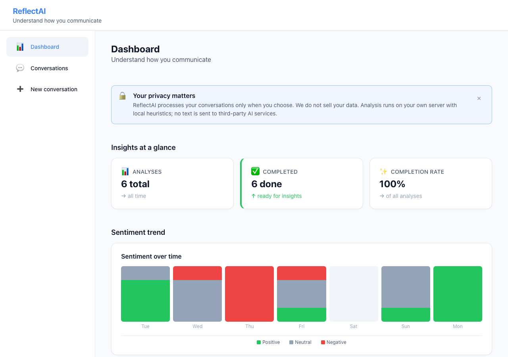
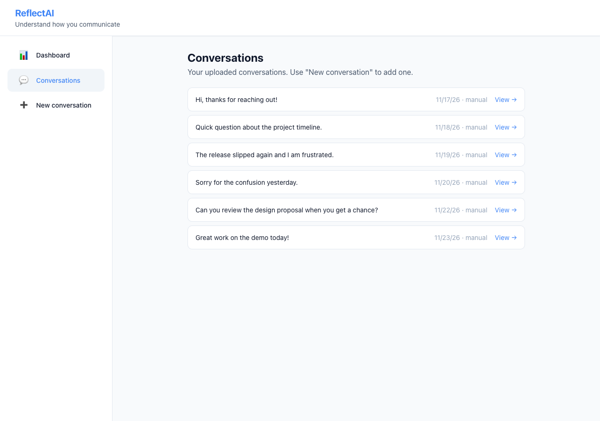
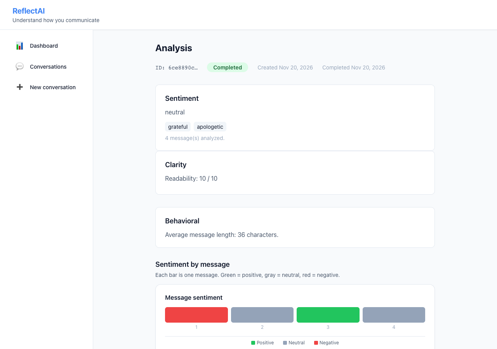

# ReflectAI

[](https://github.com/kashish14/ReflectAI/actions/workflows/ci.yml)

Paste in a conversation and ReflectAI shows how it reads: sentiment per message, the emotions that come through, how readable it is, and how messages are shaped. All analysis runs locally with explainable heuristics. No text goes to a third-party AI service and no API key is needed.



| Conversations | Analysis |
|---|---|
|  |  |

## Features

- **Dashboard**: totals, a 7-day stacked sentiment chart, and recent analyses with their overall tone
- **Conversations**: list with a first-line preview, detail page, and a one-click "Analyze"
- **New conversation**: paste text (one message per line); it is saved, analyzed, and you land on the result
- **Analysis**: overall sentiment, emotion tags (grateful, frustrated, anxious, ...), readability score, average message length, and a per-message sentiment chart
- **Privacy endpoints**: export all of a user's data as JSON, or delete it
- Seeded demo data (six conversations over the past week) so every screen has content on first run

## Tech stack

| Part | Stack |
|---|---|
| `frontend/` | Angular 21 (standalone components, signals, new control flow), SCSS, Vitest |
| `backend/` | Node.js, Express, TypeScript, Jest + Supertest. In-memory repositories, header-based demo auth |
| `analytics-engine/` | Standalone TypeScript library: sentiment scoring, tone-shift detection, clarity score, emotional trend, behavioral signals. Jest |

The backend runs its own lightweight pipeline in `backend/src/ai/`; `analytics-engine/` is a richer standalone library with its own tests and is not yet wired into the API.

## Architecture

```
Angular SPA (:4200)
   │  /api/*  (dev-server proxy, adds x-user-id: demo-user)
   ▼
Express API (:3000)  ── /v1/conversations, /v1/analyses, /v1/insights/overview, /v1/users/me/*
   │
   ├── services: ingest, analysis orchestrator, insights
   ├── ai/: preprocess → sentiment, clarity, behavioral pipelines (local, no network)
   └── repositories: in-memory, scoped by tenant + user
```

Requests carry a trace ID, logs are structured JSON with no message content, and each request is rate-limited per user. More detail in [docs/SYSTEM_ARCHITECTURE.md](docs/SYSTEM_ARCHITECTURE.md).

## Getting started

Requires Node.js 20.19+ (22 or 24 recommended) and npm 10+.

```bash
git clone https://github.com/kashish14/ReflectAI.git
cd ReflectAI
npm run install:all
```

Start the API and the web app in two terminals:

```bash
npm run start:backend    # http://localhost:3000, seeds demo data
npm run start:frontend   # http://localhost:4200
```

Open http://localhost:4200. Data lives in memory, so restarting the backend resets it to the demo seed.

Optional backend settings (all have defaults; there are no secrets to configure): `PORT`, `RATE_LIMIT_MAX`, `SEED_DEMO_DATA=false`, `STORE_RAW_CONTENT_DEFAULT`. See [backend/README.md](backend/README.md#config-env).

## Scripts

Run from the repo root:

| Script | What it does |
|---|---|
| `npm run install:all` | `npm ci` in `analytics-engine`, `backend`, `frontend` |
| `npm run build:all` | Builds all three packages |
| `npm run test:all` | Runs all unit and integration tests |
| `npm run start:backend` | API with auto-reload (`ts-node-dev`) |
| `npm run start:frontend` | Angular dev server with API proxy |

Each package also has its own `build`, `test` and `start`/`dev` scripts.

## Project structure

```
ReflectAI/
├── frontend/          Angular app: layout, dashboard, conversations, analysis
├── backend/           Express API: routes, services, ai pipelines, repositories, seed
├── analytics-engine/  Standalone analysis library
├── tests/             Shared fixtures and load-test scripts (k6 / Node)
└── docs/              Product vision, architecture, decision log, testing strategy
```

## Testing

```bash
npm run test:all
```

- `analytics-engine`: scorer, clarity score, and output-shape validation (20 tests)
- `backend`: pipelines, middleware, privacy helpers, and API integration tests with Supertest (29 tests)
- `frontend`: component and interceptor tests on Vitest (3 tests)

CI runs install, build and test for each package on Node 22 ([.github/workflows/ci.yml](.github/workflows/ci.yml)). Load-test scripts are in [tests/performance](tests/performance/README.md).

## Roadmap

- Use `analytics-engine` from the backend so the API returns clarity grades, tone shifts and trends
- Persist data in Postgres instead of memory
- Replace demo header auth with real sign-in
- Optional adapter for an LLM provider, kept off by default

## Docs

[Product vision](docs/PRODUCT_VISION.md) · [System architecture](docs/SYSTEM_ARCHITECTURE.md) · [Backend](docs/BACKEND_ARCHITECTURE.md) · [Frontend](docs/FRONTEND_ARCHITECTURE.md) · [Engineering decision log](docs/ENGINEERING_DECISION_LOG.md) · [Testing strategy](docs/TESTING_STRATEGY.md)

## License

[MIT](LICENSE)
